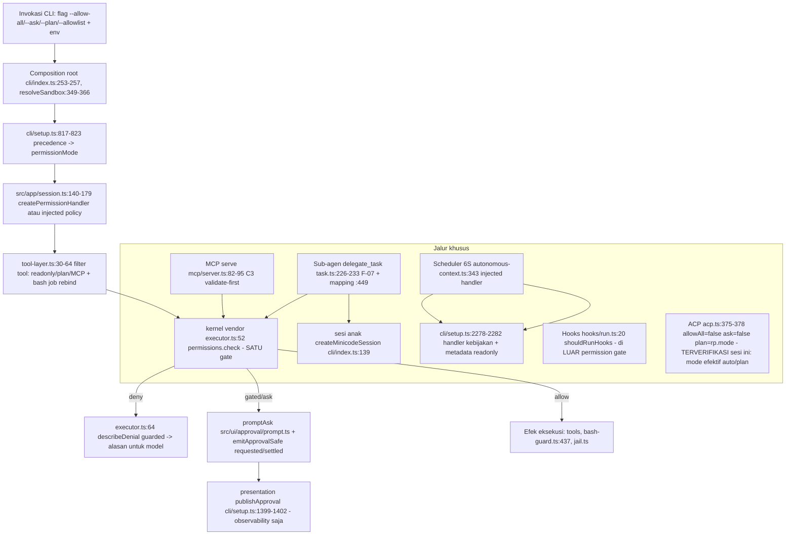

# MINICODE P12.1 — WORK MODES & PERMISSION ARCHITECTURE DESIGN

**Sifat dokumen:** paket keputusan arsitektur (design-only). Rekomendasi di
dalamnya **bukan** keputusan yang disetujui; semua keputusan pemilik berstatus
**PENDING**. Tidak ada source, test, konfigurasi, dependency, atau dokumen
ter-track yang diubah; tidak ada staging/commit/push/fetch/reset; tidak ada
test suite atau gate mahal yang dijalankan. Implementasi P12 **belum** dimulai.

**Verdict: `READY FOR OWNER DECISION`**

## 1. Executive recommendation

Bukti repo (audit P12.0 + verifikasi ulang sesi ini) menunjukkan bahwa
permission enforcement MiniCode **sudah berfungsi pada satu titik tunggal yang
benar** (`vendor/minicore/src/core/executor.ts:52`) tetapi **deklarasinya
tersebar di lima lapis** dengan jalur khusus yang melewatinya (hooks, scheduler
6S, MCP serve, ACP, sub-agen). Risiko terbesar bukan "tidak ada permission",
melainkan **kebingungan mode** dan **duplikasi kebijakan** yang dapat berbeda
arah bila salah satu lapis diubah tanpa yang lain.

Rekomendasi inti:

1. Jangan menulis engine mode baru. Perjelas dulu konsep **Work Mode (intent)**
   vs **Permission Mode (capability)** secara tertulis (D-1) lalu konsolidasi
   deklarasi lewat registry tanpa mengubah keputusan observable (D-4).
2. Pertahankan semua perilaku yang dibuktikan: jail-mendahului-mode, F-07
   forced-explore, 6U "injected handler = policy bukan mode", 6S deny-by-default,
   C3 validate-first, M15 satu jalur eksekusi, headless = deny.
3. Tanpa keputusan vendor (D-5) dan tanpa perubahan persistensi (D-2) pada
   slice awal; suite adversarial lebih dulu (P12.3) sebelum refactor apa pun.
4. Mulai P12 di atas baseline health yang diakui (D-7): 13 test gagal, 28 tsc,
   603 lint, `gate:pack`/`gate:coverage` FAIL — tanpa klaim strict-green, dengan
   gate terfokus per slice.

## 2. Tujuh keputusan pemilik (D-1…D-7)

Semua berstatus **PENDING**. Kolom "Blokir?" menandai apakah slice implementasi
mana pun tidak boleh dimulai sebelum keputusan ini ada.

### D-1 — Work Mode vs Permission Mode

| Aspek | Isi |
|---|---|
| Pertanyaan | Apakah "Work Mode" konsep terpisah dari `PermissionMode`, atau hanya sinonim? Jika terpisah, apa batas otoritasnya? |
| Perilaku saat ini | Hanya ada `PermissionMode` (`src/policy/permission.ts:18`: `auto\|readonly\|plan\|allow-all\|ask\|allowlist`). "Intent kerja" bocor ke tempat berbeda: scope tool `full\|explore` (`src/app/tool-layer.ts:14`), sub-agen `explore` dipaksa untuk parent plan/readonly/ask (`src/tools/task.ts:226-233`, F-07), budget mode ADR-25 (`task.ts:236-245`), dan prompt "Proceed to execute this plan?" pada `--plan` (`cli/index.ts:623-637`). Istilah "work mode" tidak ada di repo (grep nol). |
| Alternatif | **A)** Satu konsep saja: dokumentasikan `PermissionMode` sebagai satu-satunya mode, hancurkan sisa intent tersebar ke komentar kontrak. **B)** Dua lapis: `WorkMode` (intent: mis. plan/explore/execute) + `PermissionMode` (capability), dengan **tabel kompatibilitas terdokumentasi** dan perilaku lama tidak berubah. **C)** Engine mode baru dengan lifecycle sendiri. |
| Implikasi keamanan/kompatibilitas | A paling aman (nol perubahan) tapi tidak menyelesaikan ambiguitas yang jadi akar P12. B menambah permukaan tapi mengunci mapping eksplisit; risiko mode-confusion naik bila mapping tidak diuji. C berisiko tertinggi: menyentuh semua jalur enforcement sekaligus. |
| Rekomendasi | **B (lapis intent tipis)**, dimulai sebagai dokumentasi + tipe, tanpa mengubah `PermissionMode` atau handler. Rationale: intent sudah ada de-faktory (scope `explore`, forced-explore, plan-execute prompt); yang kurang hanya representasi eksplisit. |
| Tes & kriteria penerimaan | (i) Matriks `WorkMode × PermissionMode` direplay terhadap keputusan handler hari ini dan identik; (ii) F-07 tetap hijau; (iii) `docs/TERMINAL_CONTRACT.md` tidak berubah kecuali ditambah definisi. |
| Blokir? | **Ya** — semua slice lain menunggu arah konsep ini. |

### D-2 — Lifecycle & persistensi mode

| Aspek | Isi |
|---|---|
| Pertanyaan | State apa yang session-local, apa yang boleh bertahan lintas `--resume`, dan bagaimana bila state tersimpan bertentangan dengan kebijakan invokasi saat ini? |
| Perilaku saat ini | Mode **tidak** dipersist (grep `permissionMode` di `src/session/**` = nol). `sessionGrants` ("always") **in-memory saja**, bukan disk (`src/policy/permission.ts:180-187`). Allowlist persist di `~/.minicode/allowlist.json` (global) dan `.minicode/allowlist.json` (lokal-repo, input tak terpercaya — audit #07 P0) (`src/policy/allowlist.ts:11-14`). Mode runtime via `__setMode` tidak tersimpan ke mana pun. |
| Alternatif | **A)** Pertahankan non-persist; dokumentasikan eksplisit bahwa `--resume` = mode dihitung ulang dari flag/env. **B)** Persist mode pilihan (mis. state.json) dengan konflik → fallback aman (`auto`/flag menang). **C)** Persist juga grant "always". |
| Implikasi | A: paling aman; resume yang lupa flag akan "turun" ke `auto` — perilaku default saat ini, perlu dikomunikasikan. B: nyaman tapi membuka mode-confusion pasca-resume; butuh skema validasi. C: **ditolak** — grant stale = ancaman ekskalasi implisit (lihat T-3). |
| Rekomendasi | **A**, dengan kontrak tertulis + tes resume; B hanya bila pemilik memintanya, terpisah. |
| Tes | Tes resume: sesi dengan `--allowlist` di-resume tanpa flag → mode `auto` (atau keputusan B bila disetujui); tes "always" hilang setelah proses berakhir. |
| Blokir? | Tidak untuk slice registry/adversarial; **ya** untuk slice lifecycle. |

### D-3 — Semantik readonly & pergantian runtime

| Aspek | Isi |
|---|---|
| Pertanyaan | Apakah `readonly` boleh muncul di pemilih mode interaktif, dan apakah sesi terpaksa-restrictif dapat dilewati via `/mode`, Shift+Tab, sub-agen, atau jalur alternatif? |
| Perilaku saat ini | `MODES` TUI = `auto, ask, plan, allowlist, allow-all` — `readonly` **tidak** di siklus (`cli/tui.ts:57`, siklus `:228-233` melewati `allow-all`, `/mode` `:408`). Sesi terpaksa memakai **injected handler tanpa `__setMode`** (`src/app/session.ts:150-167`, keputusan 6U) sehingga Shift+Tab tidak dapat mencabutnya; metadata `permissionMode` tetap `"readonly"`. Sub-agen parent plan/readonly/ask dipaksa `explore` (`task.ts:226-233`). Mode metadata vs kebijakan hidup dipisahkan oleh `livePermissionMode()` (`session.ts:174-179`). |
| Alternatif | **A)** Pertahankan: readonly di luar pemilih; kebijakan terpaksa tak bisa di-set-mode (status quo). **B)** Tambah readonly ke `MODES` untuk sesi biasa (operator-initiated). |
| Implikasi | A mempertahankan prinsip "kebijakan terpaksa tidak dapat dicabut pihak yang sama yang menjalankannya" (dasar 6S F1). B aman hanya untuk sesi non-injected, tetapi membingungkan `readonly` terpaksa vs `readonly` pilihan. |
| Rekomendasi | **A**; jika pemilik menghendaki readonly pilih-able, buat entri terpisah "readonly (pilihan)" yang tetap kalah terhadap injected policy. |
| Tes | (i) `/mode` pada sesi injected tidak mengubah keputusan; (ii) Shift+Tab dari `plan` tidak membuka tulis pada sesi injected; (iii) sub-agen parent readonly = explore-only (sudah ada di `delegate-audit`). |
| Blokir? | Tidak; cukup konfirmasi arah agar refactor tidak "menyederhanakan" jalan ini. |

### D-4 — Representasi kebijakan kanonik

| Aspek | Isi |
|---|---|
| Pertanyaan | Bagaimana menghindari pernyataan permission yang kontradiktif di lima lapis: handler per-mode, tool-layer, pemetaan mode sub-agen, kebijakan otonom, dan gating hooks? |
| Perilaku saat ini | (1) `handlers: Record<PermissionMode,…>` (`permission.ts:278-301`); (2) filter tool readonly/plan + MCP (`tool-layer.ts:30-47`, `:61-64`); (3) `SubAgentSpec` subset `auto\|allowlist` + pemetaan (`task.ts:72`, `:449`); (4) matrix kapabilitas otonom (`autonomous-policy.ts:81`, `classifyTool:331`); (5) `shouldRunHooks` = `mode !== plan && mode !== readonly` (`hooks/run.ts:20`). Perbedaan nyata: semua tool MCP selalu gated oleh handler (`isGated` → `isMcpToolName`, `permission.ts:207-212`), sementara tool-layer **menyaring MCP** dari daftar tool di plan/readonly (`tool-layer.ts:61-64`) — dua mekanisme berbeda yang mengejar tujuan sama (read-only tanpa MCP), berpotensi berbeda arah bila salah satu diubah. Jangkar rapuh: `permission-matrix.test.ts` mengklaim "registry allTools tepat 37 nama". |
| Alternatif | **A)** Registry data-driven tunggal (mode → kelas tool/keputusan) yang dikonsumsi semua lapis; enforcement boundary tetap di tempatnya (defense in depth). **B)** Status quo + komentar kontrak. |
| Implikasi | A mengurangi drift tapi refactor menyentuh jalur sensitif; wajib tanpa perubahan observable + replay matriks. B: risiko drift berlanjut tiap tool baru. |
| Rekomendasi | **A**, sebagai slice terpisah no-behavior-change, dengan penggantian jangkar 37-nama oleh cakupan yang tidak rapuh. Konsolidasi **tidak** menghapus kebutuhan enforcement di boundary (jail, bash-guard, executor gate) — keduanya berbeda tanggung jawab. |
| Tes | Replay keputusan identik (old handler vs registry) untuk seluruh kombinasi mode × tool × argumen sentinel; tes paritas lintas jalur (REPL vs MCP serve vs ACP vs sub-agen vs scheduler) pada kasus yang sama. |
| Blokir? | **Ya** untuk slice konsolidasi. |

### D-5 — Batas `vendor/minicore`

| Aspek | Isi |
|---|---|
| Pertanyaan | Apakah P12 memerlukan perubahan di dalam `vendor/minicore`, atau cukup dengan kontrak executor yang ada? |
| Perilaku saat ini | Gate: `vendor/minicore/src/core/executor.ts:52` `permissions.check(...)`; seam opsional `describeDenial?` (`vendor/minicore/src/core/permission.ts:22`, dipanggil `executor.ts:64` dengan guard — observability tidak boleh menggagalkan gate). AGENTS: edit vendor hanya dengan keputusan eksplisit (seam aditif). |
| Alternatif | **A)** Tanpa edit vendor: semua kebijakan di lapis aplikasi + tes di boundary. **B)** Seam aditif vendor (mis. event perubahan mode). |
| Implikasi | A: risiko nol pada kernel; cukup untuk seluruh keputusan D-1…D-6 yang diusulkan. B: menambah luas pin vendor & sinkronisasi upstream. |
| Rekomendasi | **A**; B hanya bila bukti P12.3 menunjukkan keputusan tak dapat diuji dari luar. |
| Tes | `phase6z-m31-permission-composition.test.ts` (rantai produksi end-to-end) tetap menjadi pengunci boundary. |
| Blokir? | Tidak (asumsi A diterima diam-diam? **tidak** — tetap minta konfirmasi di tabel persetujuan). |

### D-6 — Observability denial & approval

| Aspek | Isi |
|---|---|
| Pertanyaan | Alasan denial dan hasil approval ditujukan kepada siapa: operator, log, pemanggil internal? |
| Perilaku saat ini | Model menerima alasan lewat seam kernel `describeDenial` (`permission.ts:510-520`, cap 500, hapus-saat-baca). Operator: prompt approval (`src/ui/approval/prompt.ts` via `promptAsk`, `cli/setup.ts:161`, `:1397`) + event `requested/settled` ke presentasi (`permission.ts:556-600` `emitApprovalSafe`; `ApprovalEventHook` `src/presentation/events.ts:475`). Headless/abort → deny tanpa prompt, alasan sistem (`by:"system"`, `reason:"parent-aborted"`/dsb). Tidak ada teks denial yang tampak di UI operator hari ini. |
| Alternatif | **A)** Pertahankan kontrak observable hari ini. **B)** Tambah event denial terstruktur ke presentasi (field opsional, ikut aturan versioning `docs/OUTPUT_PROTOCOL_SPEC.md` §11). **C)** Tampilkan alasan denial di TUI/statusline. |
| Implikasi | B/C menambah permukaan envelope; aman bila field opsional + tes kompat; C berisiko bocor detail internal ke skrip/log. |
| Rekomendasi | **A** untuk P12; **B** sebagai kandidat terpisah dengan ADR sendiri bila pemilik menghendaki observability. |
| Tes | Untuk A: `permission-adversarial` tetap; tes guard "observability tak menggagalkan gate" (melempar error di `describeDenial` → keputusan tetap deny). |
| Blokir? | Tidak. |

### D-7 — Baseline health & kriteria masuk implementasi

| Aspek | Isi |
|---|---|
| Pertanyaan | Bolehkah P12 berjalan di atas hutang kesehatan repo yang terdokumentasi? |
| Perilaku saat ini | Bukti P11: `gate:pack` FAIL (21/2, 4121 KB vs 2304 KB, baseline), `gate:coverage` FAIL (13 test gagal; ambang & 19/19 lantai hijau), typecheck/lint/bash/bench/audit NOT RUN pada gate final, selisih 14 vs 13 belum direkonsiliasi. 28 tsc & 603 lint = baseline warisan. |
| Alternatif | **A)** Lanjut dengan baseline terdokumentasi + gate terfokus per slice + blokir slice pada kegagalan baru yang tak terjelaskan. **B)** Tuntut test-health dulu sebagai prasyarat. |
| Implikasi | A menjaga laju tetapi "regresi nol" harus didefinisikan terhadap baseline per-slice, bukan suite hijau. B menunda P12 tanpa jaminan selesai. |
| Rekomendasi | **A**, dengan pengecualian baseline yang disetujui eksplisit pemilik (tercatat di §8). |
| Tes | Baseline terfokus per slice: `ui-boundary`, `import-convention`, `agent-contract`, `delegate-audit`, `permission-matrix`, `permission-adversarial`, `phase6s/6z` — dijalankan sebelum & sesudah tiap slice (biaya menit, bukan 1252 dtk). |
| Blokir? | **Ya** untuk memulai slice implementasi pertama. |

## 3. Arsitektur target yang diusulkan

### 3.1 Pemisahan konsep

| Konsep | Definisi yang diusulkan | Representasi hari ini |
|---|---|---|
| **Work Mode** (intent) | Niat operasional sesi: mis. `plan-work` (susun rencana), `explore` (baca-saja terbatas), `execute` (izin sesuai permission mode) | implicit: scope `full\|explore`, forced-explore F-07, prompt `--plan` |
| **Permission Mode** (capability) | Set keputusan `allow/deny` per panggilan tool | `PermissionMode` (`permission.ts:18`) |
| **Session State** | Data sesi runtime: mode live (`__setMode`), allowlist cache, sessionGrants, ledger otonom | `createPermissionHandler` state (`:178`), `sessionGrants:186` |
| **Approval Grant** | Izin per-call ("allow") atau "always" untuk identitas pola tertentu | jawaban `PermissionAsk` (`:26-29`) → `sessionGrants` in-memory |

### 3.2 Kepemilikan keputusan & enforcement

- **Owner kebijakan:** `src/policy/permission.ts` (kanonik; menyatu dengan
  registry bila D-4 disetujui) + `src/policy/{jail,bash-guard,allowlist,sandbox-policy}.ts`.
- **Owner enforcement boundary:** vendor executor (`executor.ts:52`) —
  dipanggil sekali; tidak direplikasi.
- **Owner pemetaan:** composition root (`cli/setup.ts`, `cli/index.ts`,
  `cli/tui.ts`) — satu-satunya tempat flag/env menjadi mode; DI `ask`,
  `onPermissions`, `onApprovalEvent`.
- **Kebijakan khusus (bukan mode):** 6S autonomous handler
  (`autonomous-policy.ts:438`, disuntik `autonomous-context.ts:343`), sub-agen
  mapping (`task.ts:449`), hooks predicate (`hooks/run.ts:20`).

### 3.3 Aliran data (Mermaid)

Catatan jalur tak terverifikasi penuh (ditandai): daemon-side tool calls
(`src/daemon/**`) tidak diaudit baris-per-baris dalam tugas ini; statusnya
**unverified path** untuk P12.3.

## 4. Kompatibilitas & analisis ancaman

### 4.1 Matriks kompatibilitas

| Perilaku lama (sumber) | Model target | Status |
|---|---|---|
| 6 nilai `PermissionMode` (`permission.ts:18`) | Permission Mode kanonik | dipertahankan |
| `readonly` di luar `MODES` TUI (`tui.ts:57`) | Work Mode `explore` + Permission `readonly`; readonly tetap non-selector | dipertahankan (D-3A) |
| Jail mendahului mode (`permission.ts:434`) | invariant lintas mode | dibekukan |
| allow-all tetap cek bash (`:482-486`) | invariant | dibekukan |
| F-07 forced-explore (`task.ts:226-233`) | mapping Work Mode anak | dipertahankan + tes |
| Sub-agen `auto\|allowlist` (`task.ts:72`,`:449`) | pemetaan eksplisit | dipertahankan |
| 6U injected handler tanpa `__setMode` (`session.ts:150-167`) | kebijakan terpaksa tak terganti | dibekukan |
| Headless → deny (`permission.ts:552-600`) | fail-safe default | dibekukan |
| MCP C3 validate-first (`mcp/server.ts:82-95`) | urutan gerbang MCP | dipertahankan |
| Hooks di luar gate (`hooks/run.ts:20`) | predikat tunggal | dipertahankan; kandidat diperketat terpisah |
| Exit code I28 & routing I34 (`docs/TERMINAL_CONTRACT.md`) | kontrak frozen | dibekukan |
| Kontrak `verify` P10; invarian P2 presentasi/daemon | di luar cakupan | dibekukan |

### 4.2 Model ancaman

| ID | Ancaman | Jalur nyata hari ini | Mitigasi eksisting | Rencana P12 |
|---|---|---|---|---|
| T-1 | Eskalasi via sub-agen | Delegasi dari sesi `ask` melahirkan anak `auto` (F-07 historis) | forced-explore `task.ts:226-233`; mapping allowlist `:449` | tes regresi `delegate-audit` diperluas |
| T-2 | Mode-confusion metadata vs kebijakan | `permissionMode: "readonly"` pada sesi 6S padahal kebijakan hidup adalah injected policy (`session.ts:150-167`) | `__getMode` tidak di-expose utk injected; `livePermissionMode` terpisah | dokumen + tes `/mode` pada sesi injected |
| T-3 | Grant basi (stale grants) | "always" in-memory (`permission.ts:186`) — aman; allowlist lokal `.minicode/allowlist.json` = input repo tak terpercaya (`allowlist.ts:25`, audit #07) | allowlist lokal diperlakukan sadar-berisiko; bash allowlist di-cache sekali | audit pola allowlist + tes repo-malicious |
| T-4 | Peningkatan izin via jalur alternatif | hooks di luar gate; sandbox fallback ke allowlist (`index.ts:349-366`); ACP `auto` tanpa ask (`acp.ts:375-378`, by-design IDE) | `shouldRunHooks`; `sandboxRefusalReason` fail-closed F-03 | suite P12.3 per jalur |
| T-5 | Bypass enforcement boundary | Tidak ditemukan jalur eksekusi tool kedua di luar `executor.ts:52` (M15 "satu jalur"); tetapi daemon/ACP membangun sesi sendiri | M15; C3; composition-root DI | audit baris daemon pada P12.3 (unverified) |
| T-6 | Observability merusak gate | `describeDenial` melempar error | guard `executor.ts:61-64` | tes guard wajib |
| T-7 | Refactor registry mengubah keputusan diam-diam | risiko P12.4 | replay matriks + detektor mutasi | prasyarat wajib slice konsolidasi |

## 5. Kriteria penerimaan & peta tes fokus

Label: **[R]** diturunkan dari kontrak repo; **[O]** proposal butuh persetujuan.

| ID | Kriteria | Label | Tes fokus (belum dijalankan) |
|---|---|---|---|
| AC-1 | Keputusan permission konsisten di semua jalur eksekusi (REPL, one-shot, ACP, MCP serve, sub-agen, scheduler) pada kasus identik | [R] enforcement tunggal executor | `permission-parity` (baru): kasus sentinel × 5 jalur |
| AC-2 | Paksaan tidak dapat dilewati: sesi injected tidak bisa di-`setMode`; sub-agen parent readonly/plan/ask tetap explore; hooks tetap mati di plan/readonly | [R] 6U, F-07, audit #10 | `permission-bypass` (baru) + `delegate-audit` (perluasan) |
| AC-3 | Semantik mode eksplisit & teruji per mode (termasuk allow-all tetap kena jail + bash guard) | [O D-1] | `permission-matrix` (restrukturisasi, jangkar 37-nama diganti) |
| AC-4 | Denial aman & terprediksi: `check()` = deny polos; alasan via `describeDenial` tanpa bisa menggagalkan gate; headless = deny | [R] `permission.ts:213-230`, `:552-600`, `executor.ts:61-64` | `permission-adversarial` (lanjutan) + tes guard observe-error |
| AC-5 | Warisan izin sub-agen sesuai pemetaan (allowlist→allowlist; else auto + explore untuk parent restrictif) | [R] `task.ts:226-233,449` | `delegate-audit` + matriks SubAgentSpec |
| AC-6 | Perilaku `--resume` terdefinisi: mode/grant dihitung ulang; tidak ada izin yang muncul kembali diam-diam | [O D-2A] | `resume-permission` (baru) |
| AC-7 | Kontrak terminal (I28/I34) & invarian P1–P11 tetap utuh | [R] AGENTS, TERMINAL_CONTRACT, P2/P10 closure | `ui-boundary`, `exec-json-envelope`, `cli-subcommands`, `import-convention` |
| AC-8 | Lantai liputan 19 modul kritis (termasuk `src/policy/permission.ts`) tidak turun | [R] gate coverage floors | `scripts/coverage-gate.ts` (setelah slice implementasi; mahal — jalankan dengan persetujuan D-7) |

## 6. Rencana urutan implementasi (belum dimulai)

1. **S0 — ADR & ancaman disetujui** (dokumen ini + tabel §8 diisi pemilik).
2. **S1 — Contract test atas perilaku hari ini** (matriks mode, bypass dasar,
   resume, paritas jalur) tanpa mengubah kode. Mengunci baseline.
3. **S2 — Konsolidasi registry mode** (hanya bila D-4 disetujui): tanpa
   perubahan observable; replay matriks wajib; jangkar rapuh diganti.
4. **S3 — Suite adversarial bypass** per jalur (hooks, MCP serve, ACP, 6S,
   sub-agen, env allowlist, sandbox fallback, daemon[unverified]).
5. **S4 — Lifecycle/persistensi** (hanya bila D-2/D-3 disetujui).
6. **S5 — Observability denial** (hanya bila D-6B disetujui; versioning
   `OUTPUT_PROTOCOL_SPEC` §11).
7. **S6 — Dokumen kontrak**: `docs/TERMINAL_CONTRACT.md` +
   `docs/ARCHITECTURE.html` bila perilaku berubah (wajib AGENTS).

Setiap slice: baseline terfokus → perubahan → baseline terfokus → diff
dokumen bila kontrak tersentuh. Tanpa klaim "suite hijau".

## 7. Gap bukti & pertanyaan tak terjawab

1. Definisi "Work Mode" tetap milik pemilik (D-1) — tidak ada sumber repo.
2. ADR historis (ADR-25, 6U, 6S, F-07, M15, C3) hanya ada sebagai komentar
   kode; tidak ada file ADR — S0 sebaiknya menuliskan ulang sebagai artefak.
3. Jalur daemon-side tool execution (`src/daemon/**`) belum diaudit
   baris-per-baris — **unverified**, masuk P12.3.
4. ACP: `cli/commands/acp.ts:375-378` = `allowAll:false, ask:false,
   plan:rp.mode` → mode efektif `auto`/`plan` tanpa prompt. Ini **diverifikasi
   sesi ini** (melengkapi gap P12.0) tetapi apakah "IDE auto tanpa ask" adalah
   niat desain yang diinginkan tetap perlu konfirmasi pemilik (bagian D-1/D-3).
5. Semua jumlah tes pada dokumen ini adalah **inventaris**; tidak ada tes yang
   dijalankan dalam tugas design-only ini.
6. Selisih 14 vs 13 kegagalan tetap tak terjelaskan (warisan P11) — tidak
   dijadikan dasar apa pun di sini.

## 8. Tabel persetujuan pemilik (compact)

| ID | Keputusan | Rekomendasi | Blokir implementasi? | Status |
|---|---|---|---|---|
| D-1 | Work Mode vs Permission Mode | B — lapis intent tipis + mapping kompatibel | Ya | **PENDING** |
| D-2 | Lifecycle & persistensi | A — non-persist, terdokumentasi + tes | Ya (slice lifecycle) | **PENDING** |
| D-3 | Readonly & switching runtime | A — readonly di luar pemilih; injected tak terganti | Tidak | **PENDING** |
| D-4 | Representasi kebijakan kanonik | A — registry no-behavior-change + replay | Ya (slice konsolidasi) | **PENDING** |
| D-5 | Batas vendor | A — tanpa edit vendor | Tidak (konfirmasi diperlukan) | **PENDING** |
| D-6 | Observability denial | A — pertahankan; B terpisah bila diminta | Tidak | **PENDING** |
| D-7 | Baseline health masuk P12 | A — baseline terfokus per slice + pengecualian tegas | Ya | **PENDING** |

---

*Design-only: tidak ada perubahan repo, commit, push, fetch, staging, atau
jalankan test suite/gate. Rekomendasi ≠ keputusan. P12 belum dimulai.*
