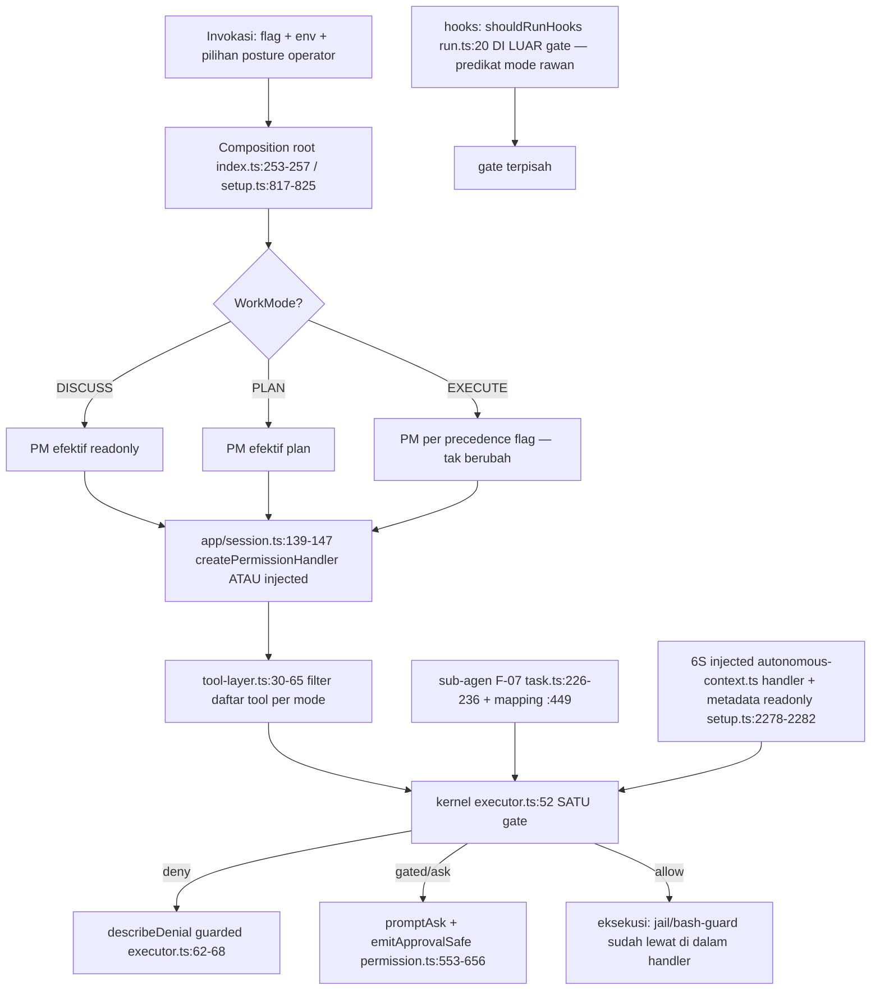

# MINICODE P12.1 — WORK MODES & PERMISSION ARCHITECTURE DESIGN (REV-1)

**Sifat dokumen:** revisi paket keputusan arsitektur (design-only). Rekomendasi
di dalamnya **bukan** keputusan yang disetujui; semua keputusan pemilik
berstatus PENDING kecuali ditandai `OWNER DIRECTION RECEIVED` (arah diterima,
persetujuan final belum). Tidak ada source, test, konfigurasi, dependency, atau
dokumen ter-track yang diubah; tidak ada staging/commit/push/fetch/reset; tidak
ada test suite atau gate mahal yang dijalankan. Implementasi P12 **belum**
dimulai.

**Basis revisi:** dua direktif pemilik (A: mode Diskusi wajib masuk desain Work
Modes; B: perubahan Minicore diizinkan bila dibutuhkan desain koheren) +
verifikasi ulang seluruh kutipan kode pada `main = 93f4179` (P11 closed,
`COMPLETE WITH DOCUMENTED LIMITATIONS`, OWNER APPROVED 2026-10-18;
`609a417..93f4179` murni dokumen — 0 berkas non-`.md`, sehingga seluruh nomor
baris kode di bawah diverifikasi ulang dan tetap berlaku).

**Verdict: `READY FOR OWNER DECISION`**

## 0. Koreksi faktual terhadap baseline (hasil verifikasi ulang di 93f4179)

- **K-1 (KOREKSI NYATA):** jawaban approval **"always" TIDAK murni in-memory**.
  `saveAlways` (`src/policy/permission.ts:262-273`) mendorong kunci ke
  `sessionGrants` (in-memory) **dan** memanggil `saveAllowlist(key, root)`
  (`:272`) yang menulis ke **`.minicode/allowlist.json` lokal-repo**
  (`src/policy/allowlist.ts:41-52` — default path = LOCAL; satu-satunya caller
  `saveAllowlist` di repo). File global `~/.minicode/allowlist.json` **tidak
  punya penulis kode sama sekali** (hanya edit manual). Read-back lokal hanya
  terjadi dengan opt-in `--allow-local-config` (`permission.ts:181,199`;
  `allowlist.ts:25-35`, audit #07) — jadi entri "always" bertahan di berkas
  repo tapi **tidak aktif secara default**; efek live hanya via
  `sessionGrants`. Klaim lama "always in-memory saja, bukan disk" (audit
  §4.1/§4.8, D-2, T-3) **salah sebagian** dan dikoreksi di sini.
- **K-2 (presisi nomor):** `allow-all` bash-inspection = `:483-496` (bukan
  :482-486); `__setMode/__getMode` = `:503-509`; `describeDenial` impl =
  `:513-515`; objek `handlers` = `:278-368`; jalur prompt/headless =
  `:553-656`; `READONLY_TOOLS` = `:31-50` (18 nama); handler `plan` =
  `:295-301`; F-07 = `:226-236` di `task.ts` (`forcedExplore` `:235` — parent
  `(plan|readonly|ask)`); mapping anak = `task.ts:449`; `EXPLORE_TOOL_NAMES`
  = `task.ts:42`; prompt `--plan` "Proceed to execute this plan? [y/N]" =
  `cli/index.ts:627`; `shouldRunHooks` diekspor dari `src/hooks/run.ts:20-22`
  dan dipakai `cli/setup.ts:1756`; ACP = `cli/commands/acp.ts:375-378`
  (`allowAll:false, ask:false, plan:rp.mode, verify:false`).
- **K-3 (tetap benar):** "Work Mode"/"workmode"/"DISCUSS" **nol hasil** di
  `src/` dan `cli/` pada HEAD saat ini — gap D-1 masih valid.

## 1. Executive recommendation (revisi)

Sama arahnya dengan baseline: jangan menulis engine mode baru; tegaskan dulu
taksonomi **Work Mode (intent)** vs **Permission Mode (capability)** (D-1),
konsolidasi deklarasi via registry tanpa perubahan observable (D-4), start di
atas baseline health terdokumentasi (D-7). Revisi REV-1:

1. **D-1 (direktif A):** taksonomi Work Mode = **DISCUSS | PLAN | EXECUTE**
   (§3). Ketiganya dipetakan ke Permission Mode yang sudah ada — DISCUSS bukan
   mode enforcement baru; ia posture + ceiling baca-saja yang sudah dapat
   direalisasikan persis oleh handler `readonly` (`permission.ts:287-288`) +
   gate hooks (`run.ts:20-22`) + filter tool-layer (`tool-layer.ts:35-41`).
   Tanpa auto-escalation (INV-WM4).
2. **D-5 (direktif B):** perubahan Minicore **diizinkan bila dibutuhkan** —
   evaluasi bukti (§5): TIDAK dibutuhkan untuk seluruh desain D-1…D-6 yang
   diusulkan; alternatif A (lapis aplikasi) tetap rekomendasi, seam aditif
   vendor disimpan sebagai opsi bersyarat bukti P12.3.
3. Seluruh invariant lama dipertahankan: jail mendahului mode, F-07
   forced-explore, 6U injected-handler-policy, 6S deny-by-default, C3
   validate-first, M15 satu jalur, headless = deny.

## 2. Tujuh keputusan pemilik (D-1…D-7, REV-1)

Status: PENDING = menunggu keputusan; ODR = OWNER DIRECTION RECEIVED (arah
diterima, persetujuan final atas rumusan ini belum).

### D-1 — Work Mode vs Permission Mode — **ODR (direktif A), rumusan REV-1 PENDING**

| Aspek | Isi |
|---|---|
| Pertanyaan | Taksonomi Work Mode resmi + batas otoritasnya terhadap `PermissionMode`. |
| Perilaku saat ini | Hanya `PermissionMode` 6 nilai (`permission.ts:18`). Intent tersebar: scope `full\|explore` (`tool-layer.ts:14`), F-07 forced-explore (`task.ts:226-236`), prompt `--plan` (`index.ts:627`), precedence flag→mode (`setup.ts:817-825`). |
| Rumusan REV-1 | **WorkMode** = posture operasional sesi (apa artefaknya, dialog seperti apa, ceiling kemampuan interaksi). **PermissionMode** = kapabilitas enforcement per panggilan tool (kata kerja allow/deny tetap miliknya). Nilai WorkMode: **DISCUSS** (diskursus; ceiling baca-saja; tanpa mutation; TANPA prompt approval; tanpa transisi implisit), **PLAN** (artefak rencana; ceiling = allow-set handler `plan` hari ini: READONLY_TOOLS + todo_write + delegate_task(explore-forced) + submit_result — `permission.ts:295-301` + `tool-layer.ts:16,37-41`), **EXECUTE** (posture default hari ini; tanpa ceiling tambahan). |
| Invariant | **INV-WM1** WorkMode tidak pernah MENAIKKAN ceiling PermissionMode; otoritas efektif = irisan (WorkMode ceiling ∧ PermissionMode ∧ injected policy ∧ jail/bash-guard/sandbox). **INV-WM2** kombinasi ilegal (mis. DISCUSS×allow-all) TETAP tercekung oleh ceiling WorkMode — WorkMode hanya boleh memperketat. **INV-WM3** sesi ber-injected-policy (6S, sub-agen F-07) tidak terpengaruh pemetaan WorkMode (tetap 6U, tak `__setMode` — `app/session.ts:148-169`). **INV-WM4** transisi DISCUSS→PLAN/EXECUTE (atau apa pun yang menambah kapabilitas) WAJIB aksi eksplisit operator; tidak pernah dipicu keluaran model. |
| Realisasi | Pemetaan di composition root (satu-satunya tempat flag/env jadi mode): `DISCUSS→PM readonly`, `PLAN→PM plan`, `EXECUTE→PM per precedence flag saat ini`. Enforcement TIDAK berubah — WorkMode adalah representasi eksplisit dari intent yang sudah de-fakto ada. |
| Tes & AC | Lihat AC-3/AC-9 + matriks §3.3 (replay 18 sel). |
| Blokir? | **Ya** untuk semua slice. |

### D-2 — Lifecycle & persistensi mode — PENDING (isi dikoreksi K-1)

| Aspek | Isi |
|---|---|
| Perilaku terverifikasi | Mode TIDAK dipersist (grep `permissionMode` di `src/session/**` nol). "always" = sessionGrants in-memory **PLUS tulis persisten ke `.minicode/allowlist.json` repo-lokal** (`permission.ts:272`; `allowlist.ts:41-52`) yang inert secara default (read-back perlu `--allow-local-config`). Mode runtime via `__setMode` tidak tersimpan. |
| Alternatif | **A)** non-persist mode + dokumentasikan bahwa "always" MENULIS berkas repo-lokal (surprise/persistence surface — kandidat dipindah ke global atau dihentikan penulisannya; perubahan perilaku = butuh keputusan sendiri). **B)** persist mode dengan konflik → fallback aman. **C)** persist "always" secara sadar (default aktif) — **tetap ditolak** tanpa kebutuhan terbukti. |
| Rekomendasi | **A** + pertanyaan baru untuk pemilik: apakah penulis "always" ke repo-lokal (input tak terpercaya, audit #07) boleh dipertahankan? |
| Blokir? | Tidak untuk slice registry/adversarial; ya untuk slice lifecycle. |

### D-3 — Readonly & switching runtime — PENDING (posisi REV-1 diperjelas)

Kontrak DISCUSS memberi jawaban parsial: readonly-pilihan-Operator kini punya
wadah (WorkMode DISCUSS), sehingga **tidak perlu** menambah `readonly` ke
siklus `MODES` TUI (`cli/tui.ts:57,228-233`). Sesi injected tetap tak
terganti (INV-WM3). Keputusan D-3 menjadi: konfirmasi bahwa DISCUSS
(pemilih posture) menggantikan kebutuhan entri siklus readonly.

### D-4 — Representasi kebijakan kanonik — PENDING (tak berubah)

Registry data-driven tunggal, no-behavior-change, replay matriks wajib,
jangkar rapuh "37 nama" diganti. Registry target WAJIB menyimpan kolom
WorkMode-ceiling (matriks §3.3) sebagai data, bukan cabang kode tersebar.

### D-5 — Batas `vendor/minicore` — **ODR (direktif B), rumusan REV-1 PENDING**

| Aspek | Isi |
|---|---|
| Direktif | Pemilik mengizinkan perubahan Minicore **bila dibutuhkan desain koheren** — bukan izinblanket; tiap edit butuh seam aditif + persetujuan eksplisit (AGENTS). |
| Evaluasi bukti | Semua enforcement mengalir lewat SATU handler terinjeksi (`vendor/minicore/src/core/executor.ts:52`; crash handler → error observation `:53-56`; guard observability `:62-68`). Kernel sudah mode-agnostic: `permissionMode` hanya string metadata ke ToolContext (`executor.ts:25,81`; kontrak handler `core/permission.ts:14-23`). Semua sesi (REPL/one-shot/ACP/MCP-serve/sub-agen/6S) dibangun lewat `src/app/session.ts:139-169` — titik intersection WorkMode-ceiling tersedia tanpa menyentuh vendor. |
| Kesimpulan | Desain REV-1 (mapping + ceiling + registry + tes bypass) **tidak membutuhkan** perubahan kernel. **Alternatif A tetap direkomendasikan.** Alternatif B (seam aditif, mis. event lifecycle mode di kernel) disimpan TERBUKA, gerbangnya bukti: bila P12.3 menemukan jalur keputusan yang membangun sesi TANPA melewati `src/app/session.ts` (kandidat: `src/daemon/**` — masih unverified) ATAU keputusan tak dapat diuji dari luar, B dievaluasi ulang dengan proposal seam terpisah. |
| Blokir? | Tidak; konfirmasi penerimaan rumusan diperlukan. |

### D-6 — Observability denial & approval — PENDING (tak berubah)

Pertahankan kontrak observable hari ini (A). Bila pemetaan WorkMode
diperlukan di UI (label posture), itu event presentasi aditif — ikut
`docs/OUTPUT_PROTOCOL_SPEC.md` §11, ADR sendiri.

### D-7 — Baseline health & kriteria masuk — PENDING (angka diperbarui)

Baseline kini resmi P11 (`P11_PHASE_CLOSURE_REPORT.md` §5.3 di `609a417`,
masih berlaku — `609a417..93f4179` dokumen saja): `gate:pack` FAIL (21/2;
4121 KB vs 2304 KB; 2 kegagalan baseline terjelaskan), `gate:coverage` FAIL
karena status test (13 gagal; funcs 87,05% ≥ 85; lines 88,06% ≥ 86; **19/19
lantai modul kritis hijau**), 28 tsc / 603 lint warisan. P11 ditutup
`COMPLETE WITH DOCUMENTED LIMITATIONS (OWNER APPROVED)` — preseden bahwa
P12 boleh berjalan di atas baseline terdokumentasi dengan gate terfokus
per-slice. Rekomendasi A tetap.

## 3. Arsitektur target REV-1

### 3.1 Konsep

| Konsep | Definisi | Representasi hari ini |
|---|---|---|
| Work Mode | Posture sesi: DISCUSS / PLAN / EXECUTE; ceiling kapabilitas interaksi; BUKAN kata kerja enforcement | implicit (explore scope, `--plan` + prompt, Shift+Tab) |
| Permission Mode | 6 nilai kanonik; allow/deny per call | `permission.ts:18` |
| Session State | mode live, allowlist cache, sessionGrants, ledger otonom | `permission.ts:178-186` |
| Approval Grant | "always" per kunci `name:argsJSON` penuh (cap arg 2 KB) | `permission.ts:262-273` + berkas repo-lokal (K-1) |

### 3.2 Aturan intersection (inti revisi)

```
otoritas efektif(call) = irisan(
    ceiling(WorkMode),            # baru: representasi, dipetakan ke PM yang ada
    PermissionMode handler,       # permission.ts:278-368 (tak berubah)
    injected policy (bila ada),   # 6S/sub-agen — 6U: tak terganti
    jail + bash-guard + sandbox)  # permission.ts:379-496 (SELALU paling dalam)
```

WorkMode hanya mempersempit. Tidak ada sel di matriks §3.3 yang mengizinkan
aksi yang tidak diizinkan PermissionMode-nya.

### 3.3 Matriks kompatibilitas WorkMode × PermissionMode (18 sel)

Notasi: **set readonly** = `READONLY_TOOLS` (`:31-50`); **set plan** = readonly
+ `todo_write`+`delegate_task`(anak forced-explore)+`submit_result`
(`:295-301`). Semua baris tetap tunduk jail/bash-guard/headless-deny.

| WorkMode \ PM | auto | ask | plan | allow-all | allowlist | readonly |
|---|---|---|---|---|---|---|
| **DISCUSS** | readonly-set, tanpa prompt | readonly-set, tanpa prompt | readonly-set | readonly-set | readonly-set | readonly-set |
| **PLAN** | set-plan | set-plan | set-plan (= identitas) | set-plan | readonly-set (irisan; gerbang write allowlist tak terbuka oleh PLAN) | readonly-set |
| **EXECUTE** | auto (identitas) | ask (identitas) | plan (identitas) | allow-all (identitas; bash guard tetap) | allowlist (identitas) | readonly (identitas) |

- Baris EXECUTE = **identitas penuh** terhadap perilaku hari ini (0 perubahan
  observable) — ini jangkar kompatibilitas slice S1–S2.
- Sel DISCUSS×* = posture baca-saja tanpa prompt; secara enforcement identik
  dengan PM `readonly` hari ini → tidak ada kode keputusan baru.
- Sel PLAN×{auto,ask,allow-all} = yang hari ini dihasilkan flag `--plan`
  (PM=plan); perubahan HANYA di representasi asal (operator memilih posture).
- Status persistensi mode & `--resume` tidak berubah (D-2).

### 3.4 Aliran (revisi minor diagram)



Predikat `shouldRunHooks` menerima **PermissionMode string mentah** — titik
rapuh: bila Posture DISCUSS direalisasikan sebagai PM `readonly` predikat
sudah benar; bila nanti ada posture baru non-PM, predikat wajib ikut
direvisi (catatan P12.2, T-8).

## 4. Kompatibilitas & ancaman (revisi)

### 4.1 Matriks kompatibilitas — tidak berubah dari baseline (semua baris
"dipertahankan/dibekukan" tetap berlaku; baris readonly-non-selector kini
mendapat alasan desain: DISCUSS mewadahinya).

### 4.2 Ancaman (delta)

| ID | Ancaman | Delta REV-1 |
|---|---|---|
| T-2bis | Label WorkMode menyesatkan ("DISCUSS = aman" padahal enforcement tetap PM) | Mitigasi: INV-WM1/2 + matriks sebagai data + tes paritas sel |
| T-3 (REVISI) | "always" tertulis ke `.minicode/allowlist.json` repo-lokal — persistensi tak disangka di input tak terpercaya; inert default, aktif bila operator lain menyalakan `--allow-local-config` | Perlakukan sebagai temuan bypass-hardening P12.3 + pertanyaan D-2 baru; tes: repo jahat berisi allowlist pre-poisoned TIDAK meng-allow tanpa opt-in (sudah ada via `allowLocal`) |
| T-8 (BARU) | Transisi posture implisit dari keluaran model (mis. teks "lanjut eksekusi") | INV-WM4; tes bypass: tidak ada API internal yang mengubah posture tanpa aksi operator |
| T-5 | daemon masih **unverified** — satu-satunya kandidat jalur sesi tanpa `src/app/session.ts`; gerbang evaluasi D-5-B | Audit baris-per-baris `src/daemon/**` di P12.3 |

## 5. Kriteria penerimaan & peta tes (revisi)

| ID | Kriteria | Label | Tes fokus |
|---|---|---|---|
| AC-1..AC-5 | (tidak berubah dari baseline; jalur parity + bypass + mapping F-07 + deny polos + I28/I34) | [R] | permission-parity / permission-bypass / delegate-audit / permission-adversarial |
| AC-3R | Matriks 18 sel §3.3 = dokumen data + replay keputusan identik vs handler hari ini untuk PM; baris EXECUTE = 0 diff | [ODR D-1] | permission-matrix restrukturisasi (jangkar 37 nama diganti) + tabel matriks sebagai fixture |
| AC-6R | Resume tidak memunculkan izin diam-diam; termasuk: entri "always" di `.minicode/allowlist.json` TETAP inert tanpa `--allow-local-config` | [R K-1] | resume-permission (baru) + tes pre-poisoned repo allowlist |
| AC-9 (BARU) | DISCUSS: (i) nol aksi tulis/exec/sensitive lolos; (ii) nol prompt approval muncul; (iii) hooks mati; (iv) tak ada transisi posture non-operator | [ODR A] | permission-workmode (baru): sentinel tulis di tiap jalur + probe prompt + probe transisi |
| AC-7/AC-8 | (tidak berubah: kontrak frozen + lantai coverage 19 modul) | [R] | ui-boundary, exec-json-envelope, cli-subcommands, import-convention, coverage-gate |

## 6. Urutan slice (revisi kecil)

S0 ADR (dokumen ini + §8) → S1 contract tests hari ini (identitas baris
EXECUTE = jangkar) → S2 registry (D-4; matriks jadi data) → S3 bypass
per-jalur (termasuk daemon + pre-poisoned allowlist + transisi posture) →
S4 lifecycle (D-2 termasuk pertanyaan berkas "always") → S5 observability
(D-6B) → S6 dokumen (TERMINAL_CONTRACT + ARCHITECTURE.html bila perilaku
berubah). DISCUSS tanpa perilaku baru: slice Representasi masuk S1/S2
(label + pemetaan), enforcement nol-baris.

## 7. Gap bukti & pertanyaan terbuka (revisi)

1. Definisi final WorkMode §3 — ODR diterima, rumusan butuh persetujuan.
2. `src/daemon/**` belum diaudit baris-per-baris — gerbang evaluasi D-5-B.
3. ACP terverifikasi (`acp.ts:375-378`); "IDE auto tanpa ask" tetap butuh
   konfirmasi niat pemilik (bagian D-1).
4. Tidak ada file ADR historis (6S/6U/F-07/M15/C3/ADR-25) — S0 menuliskannya.
5. Semua jumlah tes = inventaris; design-only: tidak ada tes dijalankan.
6. Baru: apakah penulis "always" ke repo-lokal dipertahankan/dipindah/dihenti
   (sub-keputusan D-2, konsekuensi K-1).

## 8. Tabel persetujuan pemilik (REV-1)

| ID | Keputusan | Rekomendasi REV-1 | Blokir? | Status |
|---|---|---|---|---|
| D-1 | Work Mode vs Permission Mode + DISCUSS | B-R: dua lapis; taksonomi DISCUSS/PLAN/EXECUTE; PM tak berubah; matriks §3.3 sebagai kontrak data | Ya | **ODR (A) — rumusan PENDING** |
| D-2 | Lifecycle & persistensi | A + koreksi K-1 + pertanyaan "always→berkas repo-lokal" | Ya (lifecycle) | PENDING |
| D-3 | Readonly & switching | DISCUSS menggantikan kebutuhan entri readonly di siklus | Tidak | PENDING |
| D-4 | Representasi kanonik | Registry no-behavior-change + matriks sebagai data | Ya (konsolidasi) | PENDING |
| D-5 | Batas vendor | A dulu; B terbuka bersyarat bukti daemon/P12.3 | Tidak | **ODR (B) — rumusan PENDING** |
| D-6 | Observability denial | A; B dengan ADR sendiri | Tidak | PENDING |
| D-7 | Baseline health | A (preseden closure P11 tercatat) | Ya | PENDING |

---

*REV-1 design-only: tidak ada perubahan repo, commit, push, fetch, staging,
atau jalankan test suite/gate. Rekomendasi ≠ keputusan. P12 belum dimulai.
Kutipan diverifikasi pada `main = 93f417900493572f5cdc479eb547de01707b28a6`.*
