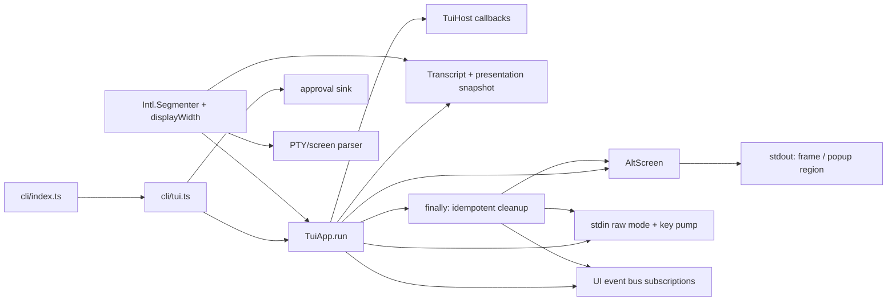

# MiniCode UI/UX Remediation — Final Report

**Tanggal:** 2026-11-06
**Repository:** `D:\Github\minicode`
**Baseline:** branch `main`, HEAD `4252b05ee9344dc03082e7857933d2007629f4d8`
**Mode:** implementation + evidence; no commit, push, release, reset, checkout,
clean, stash, or edits to owner roadmap/configuration.

## Ringkasan

Temuan UI yang dapat ditangani lokal sudah diremediasi dengan perubahan pada
lifecycle TUI, startup failure, pengukuran grapheme, parser screen test, dan
kontrak output. Semantik provider retry/transcript yang sudah tersedia tetap
dipertahankan. Working tree telah berisi perubahan sebelumnya pada sekitar 120
path ketika pekerjaan dimulai; perubahan tersebut dipertahankan dan tidak
dianggap sebagai hasil tugas ini.

Hasil ini **bukan sign-off UI/UX penuh**. Manual UAT, screen-reader UAT,
perbandingan terminal lintas OS, pengukuran CPU/heap proses anak, serta beberapa
gap proteksi terminal masih belum diverifikasi. Finding registry di bawah
mempertahankan tujuh ID dan severity dari instruksi audit. Status historis
masing-masing ID tidak dicantumkan dalam excerpt audit yang diberikan, sehingga
laporan ini tidak mengarang atau menulis ulang status historis; yang dicatat
adalah disposition dan bukti sekarang.

## Scope audit

| Area | Cakupan saat ini | Status |
|---|---|---|
| TUI lifecycle / terminal restore | `TuiApp.run()`, initial/frame/event/resize repaint, timer, signal, `AltScreen` open/paint/region/close | Diperiksa dan diuji untuk fault path yang disebutkan |
| Interactive startup | `cli/index.ts` → `cli/tui.ts` → `TuiApp.run()`; non-TTY dan terminal terlalu kecil | Diperiksa lewat subprocess dan PTY |
| Stream ownership | stdout frame, quiet linear writer, stderr diagnostic, machine output | Kontrak dikoreksi; unit/subprocess/PTY evidence tersedia |
| Unicode geometry | grapheme width, truncation, chunking, prompt cursor, frame parser, transcript PTY | Diperiksa; unit dan PTY test ditambahkan |
| Retry/transcript/presentation | jalur attempt invalidation yang sudah ada dan registry sebelumnya | Tidak diubah; test terkait dimasukkan pada regression run |
| Visual system | semantic tokens, mono/`NO_COLOR`, ASCII fallback, keyboard-first flows | Dokumentasi diperjelas; manual contrast/UAT belum dilakukan |
| Resource/performance | frame writes, input-to-visible-frame, bytes lewat PTY | Benchmark PTY lokal ditambahkan; CPU/heap child dan idle sampling belum tersedia |
| Compatibility/accessibility | Windows ConPTY saat ini, ukuran minimum, non-TTY; kebijakan width umum | Windows PTY diuji; Linux/macOS, screen reader dan terminal lain belum diverifikasi |

## Architecture map

`cli/index.ts` menangani exception yang keluar dari startup/runtime TUI sebagai
diagnostic stderr dan exit nonzero. `cli/tui.ts` memasang approval sink, lalu
selalu membersihkan sink, transcript, dan session melalui `finally`. Setelah
layar berhasil dibuka, `TuiApp.run()` menjadi owner lifecycle: ia mendaftarkan
raw input, resize, signal, timer, dan event bus lalu menjalankan satu cleanup
idempoten di `finally`. `AltScreen.paint()` dan `paintRegion()` meneruskan
exception writer kepada owner; `close()`/signal restore mencoba menutup sync
update, alternate screen, dan scroll region secara terpisah.

`width.ts` mengukur kolom berdasarkan grapheme. Fungsi yang sama dipakai oleh
truncation/chunking dan consumer UI; parser frame test kini juga menyegmentasi
grapheme sebelum menggeser grid. Kebijakan tidak mendeteksi lebar glyph setiap
terminal.

## Finding registry gabungan

### UI-RENDER-01 — Emoji/grapheme width

- **Severity:** MEDIUM (dipertahankan dari audit).
- **Lokasi:** `src/ui/render/width.ts`, `src/ui/tui/app.ts`,
  `test/helpers/tui-harness.ts`.
- **Invariant:** operasi geometri tidak boleh membelah grapheme dan harus
  memakai kolom terminal, bukan code unit/code point.
- **Evidence/reproducer:** `Intl.Segmenter` memecah input menjadi grapheme;
  `displayWidth`, `truncateToWidth`, dan `chunkByWidth` menghitung VS16,
  skin-tone, ZWJ pictograph, regional indicator, dan keycap sebagai satu
  cluster dua kolom. `test/width.test.ts`, `test/screen-buffer.test.ts`, dan
  test PTY mengirim CJK, keluarga ZWJ, flag, skin tone, keycap, serta VS16.
- **Impact:** wrapping, cursor, selection, truncation, dan tabel tidak lagi
  bergeser akibat cluster kompleks pada runtime Bun yang didukung.
- **Evidence status:** VERIFIED untuk kebijakan umum yang diuji pada Windows
  ConPTY dan helper renderer.
- **Missing tests:** terminal dengan kebijakan East Asian Ambiguous Width yang
  berbeda; glyph width aktual lintas font/terminal.
- **Acceptance criteria:** consumer berbagi helper kolom; grapheme utuh pada
  split/truncation; cursor dan frame tidak memecah cluster. Bukti yang tersedia
  memenuhi kriteria ini untuk target yang diuji.
- **Dependency:** parser terminal, input grapheme, transcript/table rendering.
- **Residual risk:** terminal tidak seragam; runtime lama tanpa
  `Intl.Segmenter` memakai fallback code point dan tidak menerima jaminan cluster
  penuh. Tidak ada probing ukuran glyph per terminal.
- **Disposition sekarang:** REMEDIATED / VERIFIED dalam batas tersebut.

### UI-RENDER-02 — Render exception melewati TUI teardown

- **Severity:** HIGH (dipertahankan).
- **Lokasi:** `src/ui/tui/app.ts`, `src/ui/runtime/screen.ts`, `cli/tui.ts`.
- **Invariant:** setiap exception setelah screen dibuka harus melepaskan
  listener, timer, subscription dan mouse mode, memulihkan raw mode serta
  alternate screen, kemudian meneruskan error.
- **Evidence/reproducer:** fault injection pada initial `getStatus`, kegagalan
  writer tengah frame, event repaint, resize repaint, `paintRegion`, dan
  partial `openAltScreen`. Test memeriksa escape restore, raw mode, listener,
  subscription, `altScreenDepth` dan error asli.
- **Impact:** terminal tertinggal di alternate screen/raw mode atau aplikasi
  terlihat hang setelah write/error.
- **Evidence status:** VERIFIED untuk fault path teruji. Signal PTY POSIX ada di
  suite; tidak dieksekusi pada Windows ConPTY dalam sesi ini.
- **Missing tests:** fault injection provider approval end-to-end dan failure
  OS signal pada POSIX di run ini; `SIGKILL` memang tidak dapat dipulihkan oleh
  cleanup aplikasi.
- **Acceptance criteria:** cleanup idempoten melalui `finally`; layar dan raw
  mode dipulihkan; runtime error tidak ditelan. Terpenuhi untuk jalur yang diuji.
- **Dependency:** kepemilikan screen, output writer, lifecycle `runTui`, dan
  session close.
- **Residual risk:** restore bergantung pada writer/terminal masih menerima
  byte. Shutdown paksa oleh OS (`SIGKILL`/Terminate Process) tidak menjalankan
  cleanup sinkron.
- **Disposition sekarang:** REMEDIATED / VERIFIED untuk tested paths; sinyal
  POSIX tetap UNVERIFIED pada host Windows ini.

### UI-COMPAT-01 — TUI startup gagal mencemari stdout dan sukses palsu

- **Severity:** MEDIUM (dipertahankan).
- **Lokasi:** `cli/index.ts`, `cli/tui.ts`, `test/tui-startup-failure.test.ts`,
  `test/pty.test.ts`.
- **Invariant:** bila fullscreen interaktif tidak dapat dimulai, stdout tidak
  menerima diagnostic atau fallback linear; stderr menjelaskan kegagalan dan
  exit status nonzero.
- **Evidence/reproducer:** subprocess produksi `--interactive` dengan pipe
  menghasilkan stdout kosong, diagnostic TTY/fullscreen di stderr, exit 1, dan
  tidak menghubungi provider. PTY 80×8 menunjukkan refusal tanpa `?1049h`;
  exit code diuji bila ConPTY menyediakannya.
- **Impact:** pipeline tidak salah membaca startup gagal sebagai jawaban kosong
  yang sukses dan tidak tercampur output UI.
- **Evidence status:** VERIFIED untuk pipe; output PTY startup diuji, exit code
  PTY tidak selalu dapat dibuktikan pada Windows ConPTY.
- **Missing tests:** pemisahan stdout/stderr pada PTY karena transport harness
  menggabungkan terminal stream.
- **Acceptance criteria:** startup refusal stderr-only + nonzero; tak ada
  alternate-screen entry; tak ada provider request. Terpenuhi pada bukti di atas.
- **Dependency:** `runTui()` refusal semantics dan outer CLI error path.
- **Residual risk:** error dari perubahan fase CLI sebelum cabang interaktif
  tetap mengikuti jalur diagnostic milik fase tersebut.
- **Disposition sekarang:** REMEDIATED / VERIFIED; exit-code PTY lintas platform
  tidak diklaim.

### UI-ARCH-01 — Kontradiksi kepemilikan stdout TUI

- **Severity:** LOW (dipertahankan).
- **Lokasi:** `docs/TERMINAL_CONTRACT.md`, `docs/OUTPUT_PROTOCOL_SPEC.md`,
  `docs/OUTPUT_RENDERING_SPEC.md`, test ownership.
- **Invariant:** saat fullscreen aktif, `App` satu-satunya owner frame stdout;
  non-interactive permanent output dan machine output tetap mengikuti protocol
  masing-masing.
- **Evidence/reproducer:** terminal contract/specs menyebut frame interaktif di
  stdout. `test/terminal-contract.test.ts` membuktikan logger linear quiet tidak
  menulis; PTY membuktikan frame produksi; writer inventory mengunci owner.
  Subprocess startup failure mengunci stdout kosong saat gagal.
- **Impact:** mencegah teks transient/linear menimpa frame dan menjaga JSON
  machine bebas dekorasi.
- **Evidence status:** VERIFIED pada helper stream, PTY produksi, dan subprocess.
- **Missing tests:** Windows CI tidak menjalankan keseluruhan suite PTY; tidak
  ada terminal PTY dengan stderr terpisah dari display stream.
- **Acceptance criteria:** dokumentasi dan implementasi memiliki model stream
  yang sama; machine output tidak bercampur. Terpenuhi pada cakupan tersebut.
- **Dependency:** screen owner, statusline arbitration, quiet linear logger,
  CLI output protocol.
- **Residual risk:** foreign process yang menulis langsung ke inherited stdout
  tetap di luar ownership guard.
- **Disposition sekarang:** REMEDIATED / VERIFIED untuk kontrak dan tested paths.

### UI-TEST-01 — Invariant terminal belum memiliki assertion khusus

- **Severity:** MEDIUM (dipertahankan).
- **Lokasi:** `test/tui-app.test.ts`, `test/screen.test.ts`,
  `test/screen-buffer.test.ts`, `test/tui-startup-failure.test.ts`,
  `test/pty.test.ts`, `test/writer-inventory.test.ts`.
- **Invariant:** klaim terminal penting harus dijaga oleh assertion pada jalur
  produksi atau test yang mereproduksi efek terminalnya.
- **Evidence/reproducer:** test baru/assertion diperluas untuk initial/frame/
  event/resize failure, popup region failure, spacer composer-footer, abort dan
  scroll saat resize terlalu kecil, startup subprocess, startup PTY kecil, serta
  grapheme di frame PTY.
- **Impact:** regressions lifecycle dan layout terdeteksi tanpa hanya menguji
  fungsi helper terisolasi.
- **Evidence status:** VERIFIED untuk assertion baru dan relevan pada tujuh
  temuan utama; sejumlah gap kontrak lain masih tersisa.
- **Missing tests:** manual UAT, announcement screen reader, I5 popup yatim pada
  semua alur, locale Indonesia pada semua projection tests, dan beberapa split
  stream/exit-code parity cases yang sudah dicatat pada bagian gap kontrak.
- **Acceptance criteria:** tiap invariant kritis yang diremediasi memiliki
  negative/positive regression proof. Terpenuhi untuk perubahan ini; tidak
  berarti semua I1–I35 ditutup.
- **Dependency:** semua finding runtime di laporan ini; reliability parser
  test-grid.
- **Residual risk:** coverage dokumen kontrak historis masih mencantumkan gap
  yang tidak ditargetkan oleh tujuh temuan ini.
- **Disposition sekarang:** PARTIALLY REMEDIATED; assertion untuk finding ini
  tersedia, full contract coverage belum selesai.

### UI-PERF-01 — Benchmark belum mengukur rendering melalui PTY

- **Severity:** LOW (dipertahankan).
- **Lokasi:** `scripts/bench-tui-pty.ts`, `test/helpers/pty-harness.ts`.
- **Invariant:** klaim latensi/output rendering terminal harus berasal dari byte
  stream PTY dan bukan interval timer sintetis saja.
- **Evidence/reproducer:** `bun scripts/bench-tui-pty.ts` mengirim prompt unik
  melalui Windows ConPTY, mengukur byte frame produksi, dan mengulang profil
  transcript yang tumbuh dengan balasan 80 baris. Run 2026-11-06: 12 input/turn,
  3.589 karakter per balasan, input-to-frame p50 **53,36 ms**, p95 **71,91 ms**,
  max **71,91 ms**; 203 full-frame writes dalam 1.953,54 ms (**103,91 write/s**)
  dan **402.855 byte**; restore `?1049l` diamati.
- **Impact:** memberi baseline operasional untuk event/input throughput tanpa
  menyamakan repaint timer dengan FPS terminal.
- **Evidence status:** VERIFIED untuk profil ConPTY di atas; angka host-specific,
  bukan SLA dan bukan benchmark lintas platform.
- **Missing tests:** sampling CPU/idle CPU, heap proses anak, resize storm,
  stream delta burst terkontrol, sesi long-running, dan baseline Linux/macOS.
- **Acceptance criteria:** ukuran input-to-frame dan output write diambil dari
  stream PTY; angka ditandai host-dependent, bukan CI threshold. Terpenuhi.
- **Dependency:** PTY provider palsu, parser grid grapheme, produksi `TuiApp`.
- **Residual risk:** profil provider palsu dan ConPTY lokal tidak memodelkan
  latensi provider, terminal emulator, atau beban CPU pengguna.
- **Disposition sekarang:** PARTIALLY REMEDIATED; PTY latency/output sekarang
  terukur, metrik resource dan variasi platform tetap terbuka.

### UI-VISUAL-01 — Aksesibilitas TUI belum lengkap

- **Severity:** INFO (dipertahankan).
- **Lokasi:** `src/ui/render/theme.ts`, `docs/OUTPUT_RENDERING_SPEC.md`.
- **Invariant:** warna bukan satu-satunya pembawa status; navigasi dasar dapat
  dilakukan dengan keyboard dan mode mono tidak menghilangkan arti status.
- **Evidence/reproducer:** theme menyediakan token semantik lazy, `NO_COLOR`
  mono path, status word/glyph, `MINICODE_ASCII`, dan keyboard shortcuts; test
  theme/input/TUI yang relevan tetap ada. Rendering spec menyebut batas dukungan.
- **Impact:** status tetap dapat dibaca tanpa kanal warna dan interaksi dasar
  tidak mensyaratkan mouse.
- **Evidence status:** PARTIAL; kode dan test otomatis tersedia, UAT assistive
  technology belum ada.
- **Missing tests:** screen reader/terminal announcement, kontras aktual pada
  beberapa tema terminal, fokus keyboard end-to-end untuk semua popup, manual
  UAT pengguna aksesibilitas.
- **Acceptance criteria:** status semantik tersedia tanpa warna; keyboard
  navigation diuji; screen-reader claims hanya dibuat setelah UAT. Dua kriteria
  pertama punya bukti, klaim screen reader tetap deferred.
- **Dependency:** frozen fullscreen contract, theme tokens, popup/input focus.
- **Residual risk:** kontrak alternate-screen tidak menyediakan mode transcript
  linear/accessibility mode; announcement semantics belum diverifikasi.
- **Disposition sekarang:** PARTIAL / UNVERIFIED untuk screen-reader use.

## Temuan tambahan

### UI-HARNESS-01 — Parser frame test memakai code unit, bukan grapheme

- **Severity:** MEDIUM untuk keandalan evidence; tidak mempengaruhi runtime.
- **Lokasi:** `test/helpers/tui-harness.ts`, `test/screen-buffer.test.ts`.
- **Invariant:** test grid harus memakai geometri yang setara dengan renderer,
  sehingga assertion PTY tidak salah menyimpulkan kolom emoji.
- **Evidence/reproducer:** parser lama mengambil `out[i]` (unit UTF-16) dan
  mengukur tiap unit; surrogate/ZWJ tidak satuan tampilan. Kini parser memakai
  `Intl.Segmenter` dan satu test membandingkan frame sequential dengan CUP pada
  kolom setelah keluarga emoji.
- **Impact:** tanpa koreksi, test dapat menyamarkan atau melaporkan drift kolom
  yang tidak sama dengan geometri frame yang dimaksud.
- **Evidence status:** FIXED / VERIFIED pada screen-buffer dan PTY Unicode test.
- **Missing tests:** parser helper tidak mengemulasikan semua DEC/OSC/terminal
  behavior.
- **Acceptance criteria:** parser menggunakan grapheme dan lebar shared helper;
  posisi setelah cluster kompleks konsisten. Terpenuhi.
- **Dependency:** UI-RENDER-01 dan semua assertion PTY berbasis screen grid.
- **Residual risk:** parser adalah model subset terminal, bukan emulator penuh.

## Dependency lintas temuan

1. **UI-RENDER-02 → UI-COMPAT-01:** kegagalan sebelum screen dibuka ditangani
   oleh startup refusal; kegagalan setelah `openAltScreen()` harus masuk
   `finally` lifecycle. Jalur ini sekarang dibuktikan secara terpisah.
2. **UI-RENDER-01 → UI-HARNESS-01 → UI-TEST-01:** perubahan lebar runtime tidak
   cukup bila parser test memakai geometri lain; parser dan test kini sama-sama
   memproses grapheme.
3. **UI-ARCH-01 → UI-COMPAT-01 / machine output:** model stdout frame,
   stderr diagnostic, dan protocol machine harus konsisten saat startup gagal
   maupun saat TUI aktif.
4. **UI-PERF-01 → UI-RENDER-01:** benchmark mengukur frame yang memakai
   geometri grapheme; hasil throughput tidak mengukur kualitas layout visual.
5. **UI-VISUAL-01 → terminal compatibility:** semantic status dan keyboard
   paths dapat diuji otomatis, tetapi screen-reader announcement dan kontras
   nyata memerlukan terminal/UAT khusus.

## Deferred verifications

Status enam item tetap **DEFERRED / UNCHANGED** sesuai instruksi; pekerjaan ini
tidak mengubah status atau mengulang pemeriksaan di luar scope UI.

| ID | Verification | Status |
|---|---|---|
| VER-01 | Windows symlink/junction race | DEFERRED / UNCHANGED |
| VER-02 | Docker integration dengan daemon nyata | DEFERRED / UNCHANGED |
| VER-03 | MCP post-accept disconnect melalui stdio | DEFERRED / UNCHANGED |
| VER-04 | Global updater installation dan rollback | DEFERRED / UNCHANGED |
| VER-05 | Live provider quality evaluation | DEFERRED / UNCHANGED |
| VER-06 | Manual UAT TUI dan gateway cache | DEFERRED / UNCHANGED |

## Risks not verified

- Manual TUI visual UAT belum dilakukan. PTY ConPTY memeriksa output byte dan
  geometri helper; ini bukan inspeksi pengalaman pengguna di Windows Terminal,
  PowerShell, CMD, Linux, atau macOS.
- Windows ConPTY pada run ini tidak memberikan exit code deterministik dan tidak
  mengirim sinyal POSIX; exit-code PTY dan SIGTERM/SIGHUP tidak diklaim lulus.
- Screen-reader announcements, kontras fisik, dan sesi assistive-technology
  belum diverifikasi.
- Lebar glyph East Asian Ambiguous dan emoji dapat berbeda antar font/terminal;
  tidak ada terminal-specific width probe.
- Benchmark PTY memakai provider lokal palsu dan tidak mengambil child CPU,
  idle CPU, atau heap. Nilainya bukan SLA dan bukan ukuran live provider.
- `bun run gate:pack` pada working tree ini gagal hanya pada ambang ukuran:
  `npm pack --dry-run` menghitung 3.969 KB unpacked, 49 KiB di atas anggaran
  3.920 KiB. Gate tidak diubah; ini blocker paket/release yang perlu ditangani
  terpisah dan bukan bukti regresi correctness UI.
- Build bundle `bun build --target=bun cli/index.ts` lulus saat output diarahkan
  ke sink. Ini memeriksa bundling CLI, bukan smoke installer/executable mandiri;
  pemeriksaan paket aktual tetap melalui `gate:pack` dan gagal pada budget di
  atas.
- `VER-01..06` tetap deferred. Manual UAT TUI tidak menutup gateway-cache
  portion dari VER-06.

## Kesimpulan

**Source remediation untuk lifecycle, startup refusal, stream ownership, dan
grapheme geometry selesai pada scope yang dapat dibuktikan lokal. UI/UX audit
dan sign-off keseluruhan belum selesai** sampai manual UAT, assistive technology,
platform lain, serta metrik resource/performance yang tersisa diverifikasi.
Tidak ada klaim release-ready atau repository-wide green dari laporan ini.

## Validation log

### Gate dan regresi

| Command | Hasil |
|---|---|
| `bun x tsc --noEmit` | PASS pada working tree ini. |
| `bun run lint` | PASS; Biome memeriksa 679 file, tanpa perubahan tambahan. |
| `bun test` | PASS — 5.523 pass, 19 skip, 0 fail; 390.613 assertions; 5.542 test di 383 file; 1.053,49 detik. |
| `bun run gate:coverage` | PASS — fungsi 88,29% (min 87), baris 89,62% (min 86), lantai 19/19 modul kritis. |
| `bun run gate:pack` | FAIL ukuran saja — 22 pass, 1 fail; 3.969 KB unpacked vs budget 3.920 KiB (+49 KiB). |
| `bun run audit:harness` | PASS — 60 pass, 0 fail, 2 advisory (benchmark fake dan hasil SWE-bench belum tersedia). |
| `bun build --target=bun cli/index.ts > $null` | PASS — bundle CLI ditulis ke stdout sink; tidak membuat output build di repository. Bukan installer/executable smoke. |
| `bun run bench:smoke` | PASS — 13/13 fake benchmark; advisory saja, bukan klaim kemampuan model. |
| `bun scripts/bench-tui-pty.ts` | PASS; metrik Windows ConPTY tercatat pada UI-PERF-01. |
| Focused post-fix reruns | PASS — signal 2, Unicode PTY 1, transcript 2, architecture guard 52; semua gagal awal yang terkait patch tertutup. |
| `git diff --check` | PASS; tidak ada whitespace/error diff. |

Hasil targeted suite sebelum full regression: lifecycle TUI, screen, grapheme,
screen parser, startup subprocess, dan PTY test yang applicable lulus. Run
pertama writer inventory menandai empat write tambahan yang sengaja dipakai
untuk restore independen; batas inventory diperbarui dengan alasan itu, dan
status finalnya ditentukan oleh `bun test` penuh. Dari 19 skip suite, beberapa
bergantung pada provider live, Docker, symlink/TOCTOU atau CI Linux; tes exit
code dan sinyal POSIX PTY memang tidak dapat diverifikasi oleh Windows ConPTY.
Index Git tidak di-stage. Working tree tetap berisi banyak perubahan awal dan
hasil tugas; tidak ada commit, push, reset, checkout, clean, atau stash.
Saat mulai, sekitar 120 path sudah dirty; pemeriksaan akhir menunjukkan 135
path dirty, 0 staged, dan tidak ada output build di repository.
